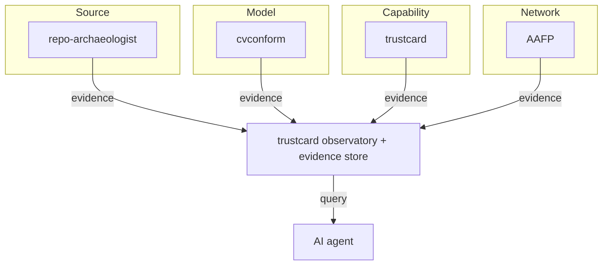

# Trust Stack Vision

## One-sentence pitch

A trust infrastructure company that produces verifiable evidence for every hand-off in the AI/ML supply chain — source code, models, capabilities, and agent-to-agent connections — with `trustcard` as the cryptographic spine.

## The problem

Modern software companies inherit repos, import models, wire AI tools, and deploy agents, but each of these hand-offs is trusted on vibes:

- "This repo looks maintained."
- "This quantized model should still work."
- "This MCP server is probably fine."
- "This agent connection is secure enough."

There is no shared evidence layer. Source risk, model drift, capability tampering, and network compromise are all separate concerns, each with their own ad-hoc checks. No single system lets an operator ask: **"What evidence do I have that the entire chain is still what I expect?"**

## The four layers

| Layer | What is at risk | Evidence producer | Key question |
|---|---|---|---|
| **Source** | Inherited or third-party code | `repo-archaeologist` | What is this repo, what is dead, what is dangerous? |
| **Model** | Exported, quantized, or compiled models | `cvconform` | Is this still the same model after conversion? |
| **Capability** | MCP servers, OpenAPI endpoints, gRPC services | `trustcard` | Is this the capability I pinned, and is this call allowed? |
| **Network** | Agent-to-agent connections | `AAFP` | Is this connection post-quantum authenticated and attested? |

Each layer answers a distinct question, but the evidence is interoperable.

## Why trustcard is the spine

`trustcard` already provides:

- **Content-addressed identity** — every capability, tool, and manifest has a stable `sha256:` digest.
- **Signed, tamper-evident evidence** — `lib/evidence.js` records what was observed, by what method, when, and with what confidence.
- **Fail-closed enforcement** — Gate 1 (identity continuity) + Gate 2 (per-call invocation policy) + v3 evidence substrate.
- **Protocol neutrality** — the evidence format is not MCP-specific; it can absorb repo, model, and network observations.
- **No new runtime dependencies** — the adapters can be pure functions over existing outputs.

The other three projects become **evidence producers** that feed the trustcard store. They do not become trustcard; they make trustcard more useful.

## How a software company uses it

### 1. Source onboarding

A company inherits a repo. `repo-archaeologist` scans it and produces `ARCHITECTURE.md`, `SECURITY.md`, `FIRST_15_MINUTES.md`, and a structured report. The trustcard adapter turns that report into evidence:

- `repo-architecture-scanned`
- `repo-dead-code-estimated`
- `repo-security-scanned`
- `repo-risk-level`

This evidence is stored before any human edits the code.

### 2. Model release gate

A model is exported to ONNX, CoreML, TFLite, or TensorRT. `cvconform` runs differential conformance between the reference and the target, plus failure discovery. It produces evidence:

- `model-runtime-verified`
- `model-conformant`
- `model-divergence-detected`
- `model-fault-family`

The release is blocked if `model-conformant` is `false`.

### 3. Capability procurement

An MCP server is added to the registry. `trustcard` observes `tools/list`, compares it to the signed manifest, runs the behavioral engine, and produces evidence:

- `handshake-succeeds`
- `tools-exposed`
- `destructive-capability-detected`
- `injection-marker-detected`
- `behavior-probe-passed`

A dangerous tool is stripped from `tools/list` by the proxy.

### 4. Agent federation

Two agents connect over `AAFP`. The handshake binds ML-DSA-65 identity, X25519MLKEM768 key exchange, and transcript hash. The adapter produces evidence:

- `transport-attestation-observed`
- `agent-record-versioned`
- `handshake-bound-to-server-digest`

Every MCP call over that transport gets a signed receipt linked to the attestation.

## The single observatory



A single command runs all four layers:

```bash
mcp-trustcard observatory run \
  --repo ./my-service \
  --model ./my-model.onnx \
  --mcp-server "node my-mcp-server.js" \
  --aafp-endpoint "quic://peer.example:4433"
```

The agent can then query the evidence store before taking action:

```bash
mcp-trustcard evidence query model-conformant --subject my-model
mcp-trustcard evidence contradictions --subject my-service
```

## Why this is a company, not just a product

The infrastructure has four complementary revenue or cost-saving angles:

1. **Source intelligence** — reduce time to understand inherited repos and quantify technical debt.
2. **Model conformance** — prevent silent quantization and export bugs that break production.
3. **Capability trust** — make AI tool procurement evidence-based instead of reputation-based.
4. **Agent networking** — sell the post-quantum, attestable transport for autonomous agent fleets.

The common thread is **evidence as a service**. Every layer produces signed, content-addressed, tamper-evident observations that can be queried, exported, and audited.

## Roadmap

The work is sequenced by the trustcard `ROADMAP-PREMIER-TRUST.md`:

- **M1 — Capability descriptor CLI:** make the protocol-neutral descriptor a first-class CLI artifact. (cvconform / repo-archaeologist outputs become descriptors.)
- **M2 — Multi-protocol identity adapters:** extend descriptors to OpenAPI, gRPC, and AAFP endpoints.
- **M3 — trustcard as an MCP server:** expose `verify_descriptor`, `query_pins`, `sign_evidence`, and `issue_auth_token` as tools.
- **M4 — Continuous observatory and evidence network:** the `observatory` command, cross-observatory evidence exchange, and the public evidence corpus.

## Phase 1 status

Phase 1 (this document) delivers:

- Green test matrix across `trustcard`, `repo-archaeologist`, `cvconform`, `aafp-go`, and `aafp` (Rust).
- `trustcard/docs/RFC-INTEGRATED-TRUST-STACK.md` — the integration spec.
- This vision document.
- A MAOS blackboard goal tracking the integrated trust stack.

Phase 2 will implement the three new evidence adapters in `trustcard/lib/evidence-adapters.js` and the `observatory` CLI command.
